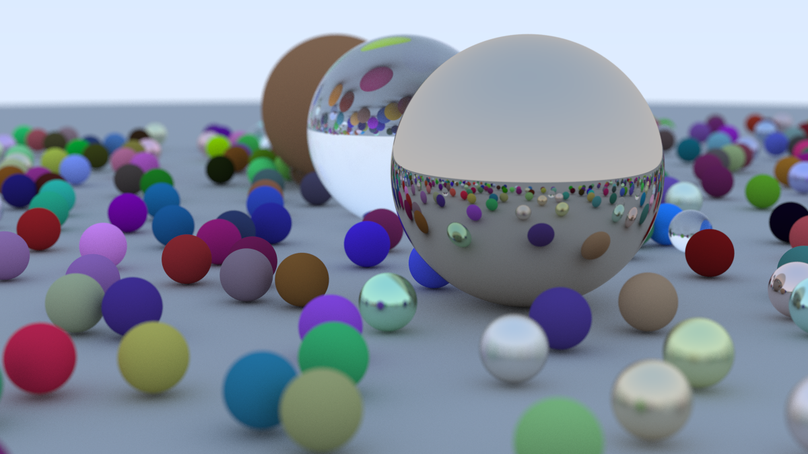

Building a ray tracer in zig using the "Ray Tracing in One Weekend" and "Ray Tracing: The Next Week" books.

Build with Zig 0.17 and CMake installed:

```sh
zig build
```

The build fetches the pinned mlx-c package through Zig, then builds its native
static libraries with CMake. CMake downloads MLX and its native dependencies on
the first build; no Python package is needed. Zig compiles the application to an
object, and a small CMake project links it using MLX's exported platform and C++
runtime dependencies. Cross-compilation is not supported; build on the target OS.

Backend selection:

| Host | Default | Requirements |
| --- | --- | --- |
| Apple-silicon macOS | Metal GPU, JIT enabled, CPU backend disabled | Xcode and its Metal compiler |
| Linux, including Asahi on Apple silicon | CPU | C++20 compiler, BLAS/LAPACK and LAPACKE development files |
| Linux with NVIDIA GPU | Opt in to CUDA | Compatible CUDA toolkit, cuDNN, NVIDIA driver; CPU dependencies by default |

```sh
zig build run                          # Platform default
zig build run -Dmlx-backend=cpu         # CPU only, on macOS or Linux
zig build run -Dmlx-backend=cuda        # Linux + NVIDIA CUDA
zig build run -Dmlx-backend=metal       # Apple-silicon macOS
zig build run -Dmlx-backend=metal -Dmlx-cpu=true # Include CPU fallback
```

`-Dmlx-backend=auto` is the default. CPU support defaults to enabled for CPU/CUDA
builds and disabled for Metal; use `-Dmlx-cpu=false` to omit it from CUDA builds.
The example prefers an available GPU, otherwise uses the CPU, and reports its
selection. It fails clearly if neither backend has an available device.

The native macOS GPU build requires Apple's Metal compiler (`xcrun -sdk macosx
metal --version`), available through Xcode and its Metal toolchain. On Ubuntu,
the upstream CPU-build prerequisites include `libblas-dev`, `liblapack-dev`, and
`liblapacke-dev`; install equivalent development packages on other distributions.
Safetensors, GGUF, and Metal debug support stay disabled. mlx-c also disables
MLX tests, examples, benchmarks, and Python bindings.

The build translates the pinned C headers, then runs `tools/generate_mlx.zig`
to emit a normal Zig module with public aliases. `mlx_array` becomes `mlx.array`,
`mlx_array_new` becomes `mlx.array_new`, and `MLX_FLOAT32` becomes `mlx.FLOAT32`.
Types retain their identity and C ABI; signatures and return codes are unchanged.
Compiler diagnostics may still display the original translated C type name.
The mutable `mlx_array_empty` global is exposed as a pointer, `mlx.array_empty`.

`zig build` automatically generates bindings when they are missing or stale;
unchanged builds reuse the cached bindings. Changes to the headers, generator,
or Zig toolchain invalidate the relevant cache entries.
`zig build bindgen` runs just the binding-generation pipeline without compiling
native MLX or the application. It also respects the cache.
Use `zig build bindgen --summary all` to see which steps were cached.
`zig build test` checks generation, type aliases, and lazy declarations.
MLX and mlx-c are statically linked into `zig-out/bin/ray-tracer`; no MLX dylibs
or shared objects are needed. System C++ runtime, platform libraries, and any
BLAS/LAPACK or NVIDIA dependencies may remain dynamic.
Metal builds enable JIT, with a first-use compilation cost. This MLX release
still requires a smaller `mlx.metallib` for remaining precompiled kernels. The
build installs it beside the executable automatically; distribute both files.
CPU/CUDA builds do not install a Metal resource. `zig build run` executes the
installed layout. Reusing an old install directory may leave obsolete artifacts;
a fresh `--prefix` directory contains just the selected build's outputs.




